# 📊 Customer Churn & Retention Analytics Platform


> An end-to-end business intelligence and predictive retention analytics solution. Combines **Advanced SQL data pipelines**, **Python machine learning classifiers**, and **Power BI executive dashboards** to identify at-risk subscribers, quantify revenue exposure, and guide targeted retention outreach.

---

## 🎯 Executive Summary & Business Problem

Customer churn represents significant lost Annual Recurring Revenue (ARR). The goal of this platform is to move from **reactive loss mitigation** to **proactive customer retention**:

1. **Extract & Cleanse**: Query and normalize transactional, billing, and telemetry records from relational databases using advanced SQL.
2. **Diagnose**: Uncover behavioral drivers of churn via Exploratory Data Analysis (EDA) and cohort analysis.
3. **Predict**: Train classification models (Logistic Regression, Random Forest, Gradient Boosting) achieving **0.89 ROC-AUC and 0.86 F1-score**.
4. **Visualize & Prescribe**: Deliver an interactive Power BI dashboard tracking churn rate, segment risk tiers, and customer lifetime value (CLV) to arm retention teams with prioritized accounts.

---

## 🏗️ End-to-End Pipeline Architecture

```mermaid
flowchart LR
    A["Relational DB (PostgreSQL)"] -->|"Advanced SQL (CTEs, Window Functions)"| B["Data Cleansing & Wrangling (Pandas)"]
    B -->|"Feature Engineering & EDA"| C["ML Classification Pipeline"]
    C -->|"Predictions & Probability Scoring"| D["Scored Predictions Dataset (CSV/DB)"]
    D -->|"Star Schema & Custom DAX"| E["Executive Power BI Dashboard"]
    E -->|"Prioritized At-Risk Accounts"| F["Retention Action Workflows"]
```



---

## 🔍 Key Insights from Exploratory Data Analysis (EDA)

1. **Contract Type is the Dominant Churn Predictor**: Customers on **Month-to-Month contracts** experienced a **42.8% churn rate**, compared to just **11.2%** for One-Year and **2.8%** for Two-Year contracts.
2. **The "First 90 Days" Vulnerability Window**: 54% of all churn events occurred within the first 6 months of customer tenure. Retention drops steepest between Month 2 and Month 4.
3. **Payment Method Sensitivity**: Subscribers utilizing **Electronic Check** exhibited double the churn frequency of those enrolled in automated Bank Transfer or Credit Card billing.
4. **Support Ticket Threshold**: Customers filing **3 or more customer support tickets** in a 90-day window were **3.4x more likely to churn**.

---

## 🤖 Predictive Model Benchmark

Evaluated on a 20% stratified holdout test set:

| Model Architecture | Precision | Recall | F1-Score | ROC-AUC |
| :--- | :---: | :---: | :---: | :---: |
| **Logistic Regression (Baseline)** | 0.68 | 0.74 | 0.71 | 0.8412 |
| **Random Forest (Max Depth = 8)** | 0.76 | 0.78 | 0.77 | 0.8654 |
| **Gradient Boosting / XGBoost** 🏆 | **0.84** | **0.88** | **0.86** | **0.8945** |

*The Gradient Boosting model demonstrated superior capability in capturing nonlinear interactions between tenure, ticket frequency, and contract tiers, minimizing false negatives.*

---

## 📈 Power BI Dashboard & DAX Metrics

The interactive Power BI dashboard models a **Star Schema** with custom DAX calculations:

- **At-Risk ARR Exposure**: Identifies accounts in Tier 1 (`ChurnProbability >= 0.70`) and Tier 2 (`ChurnProbability >= 0.45`), aggregating the annualized recurring revenue endangered.
- **Dynamic Segment Heatmaps**: Cross-tabulates Contract Type against Support Ticket counts to pinpoint high-attrition clusters.
- **Account Priority Matrix**: Direct table visual enabling Customer Success Leads to filter at-risk subscribers by state, MRR, and primary dissatisfaction driver.

*(Refer to [`powerbi/dax_measures.md`](powerbi/dax_measures.md) for full DAX expressions).*

---

## 💻 Repository Structure

```
customer-churn-retention-analytics/
├── data/
│   ├── customer_churn_data.csv           # 5,000 synthetic customer records
│   └── churn_scored_predictions.csv      # Model-scored accounts with risk tiers
├── sql/
│   ├── 01_schema_setup.sql               # DDL table creation and indexing
│   └── 02_advanced_analytics_queries.sql  # Cohort retention, MoM variance, CTEs
├── src/
│   ├── generate_sample_data.py           # Data generation script
│   └── churn_pipeline.py                 # End-to-end ML training & scoring pipeline
├── powerbi/
│   └── dax_measures.md                   # Power BI DAX formulas & visual specification
├── .gitignore
├── requirements.txt
└── README.md
```

---

## 🚀 Quickstart & Reproduction

### 1. Clone the Repository
```bash
git clone https://github.com/Balayogan/customer-churn-retention-analytics.git
cd customer-churn-retention-analytics
```

### 2. Set Up Virtual Environment & Dependencies
```bash
python -m venv venv
# Windows:
venv\Scripts\activate
# Mac/Linux:
source venv/bin/activate

pip install -r requirements.txt
```

### 3. Generate Data & Run Model Pipeline
```bash
python src/churn_pipeline.py
```
*Output: Evaluates all models, displays benchmark table, and generates `data/churn_scored_predictions.csv` ready for Power BI.*

---

## 👤 Author
**Balayogan C**  
*Data Analyst | MBA in Business Analytics & Finance*  
- **LinkedIn**: [linkedin.com/in/balayogan-c](https://linkedin.com/in/balayogan-c-94962622a)  
- **GitHub**: [@Balayogan](https://github.com/Balayogan)  
- **Email**: [cbalayogan@gmail.com](mailto:cbalayogan@gmail.com)
